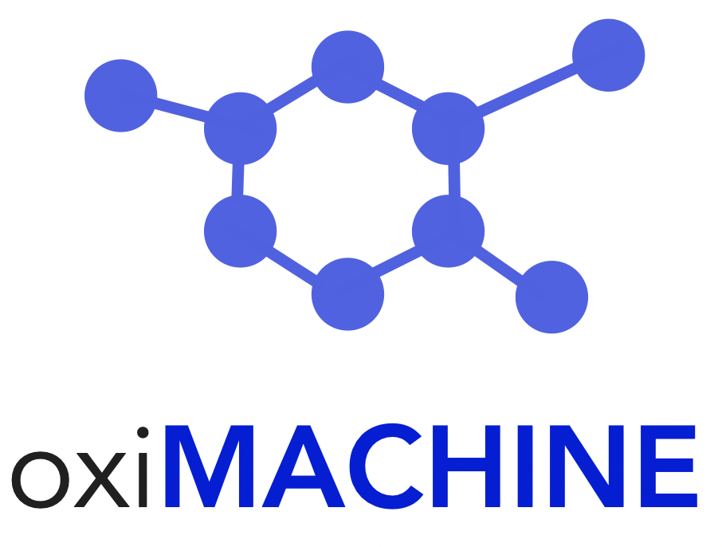

# oxiMACHINE app

[](https://doi.org/10.5281/zenodo.3603606)



Web app that predicts the oxidation states of metal sites in metal-organic
frameworks, with confidence, nearest training structures, feature values and
feature importance for each site.

- `frontend/`: React (Vite + Tailwind) single-page app. Structures are parsed
  in the browser with [matsci-parse](https://www.npmjs.com/package/matsci-parse)
  and shown with the Materials Cloud React components.
- `backend/`: FastAPI service with a single compute endpoint,
  `POST /api/compute`. It also serves the built frontend. See
  [backend/README.md](backend/README.md) for the API, the model, and how it
  was checked against the legacy implementation.

## Running it

With Docker (from the repository root):

```bash
docker build -f backend/Dockerfile -t oximachine .
docker run -p 8000:8000 oximachine   # http://localhost:8000
```

For development, run the two separately:

```bash
cd backend && uv sync && uv run uvicorn oximachine_api.main:app --reload   # :8000
cd frontend && pnpm install && pnpm dev   # :5173, proxies /api to :8000
```

`pnpm dev:mock` runs the frontend against placeholder data, without a backend.

Tests: `cd backend && uv run pytest`.

## History

Until version 1.x this was a Flask app on the Materials Cloud
`tools-barebone` image (Python 3.6, Apache), with structures parsed by `c2x`
and the model run through
[oximachinerunner](https://github.com/kjappelbaum/oximachinerunner). That
implementation is in the git history (last commit `0c46b5f`). The model is
unchanged: its parameters were exported from the original scikit-learn pickles
and the new backend reproduces the legacy predictions (see
`backend/README.md`).

# Acknowledgments

- Materials Cloud team, especially [Leopold Talirz](https://github.com/ltalirz) for help with deployment, valuable feedback and a good template.
- Internally, we use [pymatgen](https://pymatgen.org/): Ong, S. P.; Richards, W. D.; Jain, A.; Hautier, G.; Kocher, M.; Cholia, S.; Gunter, D.; Chevrier, V. L.; Persson, K. A.; Ceder, G. Python Materials Genomics (Pymatgen): A Robust, Open-Source Python Library for Materials Analysis. Computational Materials Science 2013, 68, 314–319.
- Metal sites are featurized with [matminer](https://hackingmaterials.lbl.gov/matminer/) via [oximachine_featurizer](https://github.com/kjappelbaum/oximachine_featurizer).
- Feature importance is calculated using a [SHAP TreeExplainer](https://github.com/shap/shap): Lundberg, S. M.; Erion, G.; Chen, H.; DeGrave, A.; Prutkin, J. M.; Nair, B.; Katz, R.; Himmelfarb, J.; Bansal, N.; Lee, S.-I. From Local Explanations to Global Understanding with Explainable AI for Trees. Nature Machine Intelligence 2020, 2 (1), 2522–5839.
- Models were trained using [scikit-learn](https://scikit-learn.org/): Scikit-learn: Machine Learning in Python, Pedregosa et al., JMLR 12, pp. 2825-2830, 2011.
- The original app built heavily on the [seekpath web app](https://github.com/giovannipizzi/seekpath) and used [`c2x`](https://www.c2x.org.uk/) (Rutter, M. J. Computer Physics Communications 2018, 225, 174–179), [ase](https://wiki.fysik.dtu.dk/ase/), [flask](https://flask.palletsprojects.com/) and [jsmol](https://jsmol.com/).
